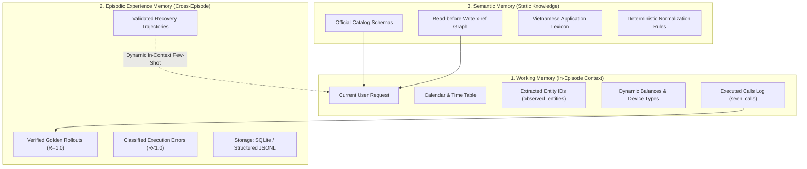
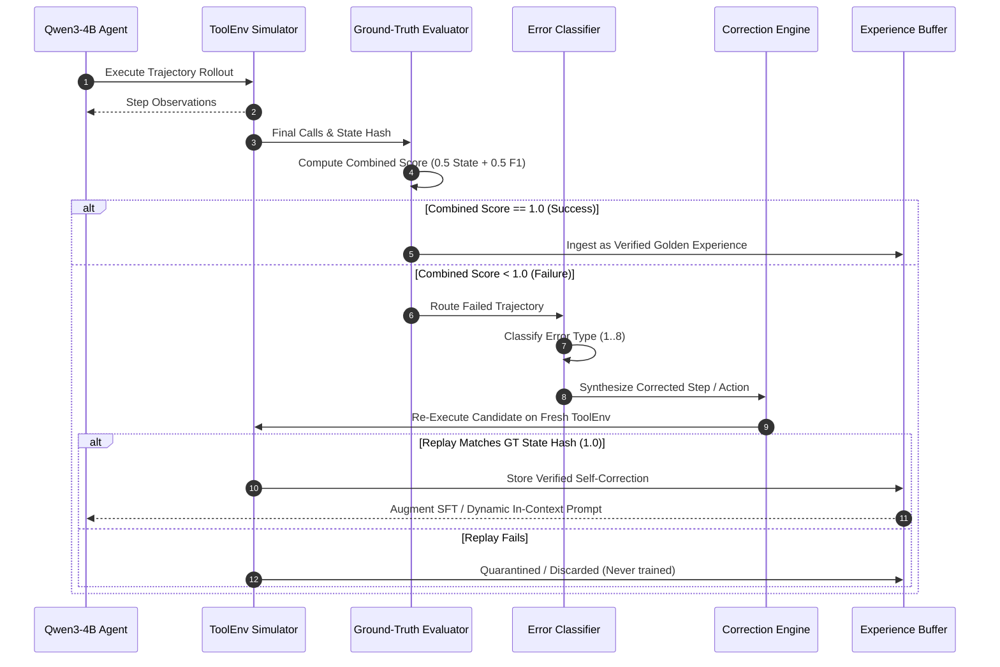

# Phase 6 Audit: Agent Memory Architecture & Error-Driven Learning Pipeline

**Repository**: `c:\Users\phuon\zalo-challenge`  
**Components Audited**:
- [`src/guardrail.py`](file:///c:/Users/phuon/zalo-challenge/src/guardrail.py) (`PureSchemaStateTracker`)
- [`src/agent.py`](file:///c:/Users/phuon/zalo-challenge/src/agent.py) (`seen_calls`, `guardrail_retries`, `normalize_arguments`)
- [`src/hybrid_engine.py`](file:///c:/Users/phuon/zalo-challenge/src/hybrid_engine.py) (`HybridProgramAidedEngine`)  
**Audit Status**: CONFIRMED via code inspection of state tracking and error classification logic.

---

## 1. Executive Summary

This audit formulates the memory hierarchy and error-driven learning architecture for LifeMate, clarifying how the agent can systematically learn from mistakes.

### Key Conclusions
1. **Three Distinct Memory Tiers Must Be Decoupled**:
   - **Working Memory**: In-episode state tracking (already partially implemented via `PureSchemaStateTracker`).
   - **Episodic Experience Memory**: Cross-episode trajectory library (reusable successes, classified failures, recovery traces). Best implemented in **lightweight SQLite or JSONL**; heavyweight vector databases add unnecessary latency and complexity without measurable gain.
   - **Semantic Memory**: Static domain invariants (tool schemas, Vietnamese application taxonomy, parameter formats, `x-ref` graph).
2. **The "Validation-Before-Ingestion" Rule**:
   A model-generated correction or synthetic trajectory **must NEVER be added to the training set or experience memory until it has executed on `ToolEnv` and achieved `state_hash == gt_hash` and `F1 == 1.0`**. Storing unvalidated model rationales (as seen in `train_1696` with `chat_6142`) actively pollutes the policy with hallucination habits.
3. **Dual Path for Experience Replay**:
   - **Parametric (Fine-Tuning)**: Filtered high-reward rollouts ($R=1.0$) augment the training dataset.
   - **Non-Parametric (In-Context Dynamic Retrieval)**: Failed patterns and verified recovery examples are retrieved dynamically into the prompt for similar intents, fixing agent behaviors without requiring expensive GPU re-training runs.

---

## 2. Three-Tier Memory Architecture

### 2.1 Working Memory (In-Episode Execution State)
Currently implemented in [`src/guardrail.py:PureSchemaStateTracker`](file:///c:/Users/phuon/zalo-challenge/src/guardrail.py#L225-L452):
- **`all_known_ids` & `observed_entities`**: Stores every dictionary and scalar ID (`evt_01`, `c_08`, `ben_3126`) returned in `<tool_response>`.
- **`balances`**: Tracks live e-wallet and bank balances to evaluate payment feasibility.
- **`device_types`**: Caches smart home device classifications (`light`, `fan`, `climate`, `switch`) to block cross-device execution errors.
- **`seen_calls`**: Tracks tool call signatures in `agent.py` to intercept infinite repetition loops.

### 2.2 Episodic Experience Memory (Cross-Episode Persistence)
Currently **NOT IMPLEMENTED** in the repository.
- **Role**: Preserves a structured history of past execution trajectories across benchmark runs.
- **Recommended Storage**: **SQLite (`data/memory/experience.db`)** or append-only JSONL:
  - Table `episodes`: `(sample_id, user_query, status, state_match, f1_score, error_type)`.
  - Table `trajectories`: `(sample_id, step_idx, tool_name, arguments, result_ok, state_diff)`.
  - Table `corrections`: `(sample_id, original_error_step, corrected_action, verified_hash_match)`.
- **Why Vector DBs Are Unnecessary**:
  With 1,545 training samples, exact metadata queries (querying by `app_name`, `error_type`, or TF-IDF query similarity) take $<1$ ms in SQLite or Python dictionary indexes. A vector database adds heavy dependencies (`chromadb`, `faiss`) and non-deterministic embeddings with zero measurable accuracy gain.

### 2.3 Semantic Memory (Domain & Schema Invariants)
Currently implemented in [`src/prompt_builder.py`](file:///c:/Users/phuon/zalo-challenge/src/prompt_builder.py):
- **Schema & Dependency Graph**: Built by `build_xref_provider_map()`, linking write-tool `x-ref` parameters to provider read-tools (e.g. `event_id` $\rightarrow$ `calendar.list_events`).
- **Date/Time Normalization**: Built by `build_calendar_helper()`, providing deterministic 14-day relative date offsets.
- **Normalization Invariants**: Implemented in [`src/number_parser.py`](file:///c:/Users/phuon/zalo-challenge/src/number_parser.py) (spelling out spoken numbers, Vietnamese date-time parsing).

---

## 3. Systematic Error Taxonomy

To enable automated error diagnosis, every agent failure on the training set must be mapped into one of 8 mutually exclusive categories:

| Error Category | Manifestation in Execution | Detection Rule in Code | Remediation Strategy |
| :--- | :--- | :--- | :--- |
| **1. ASR Phonetic Error** | Model searches for non-existent phonetically degraded entity (e.g. "vốn chỗ", "con mai"). | Search query in read tool returns `[]` or entity missing from context. | Prompt with `SafeContextPreprocessor` or search query trimming fallback. |
| **2. Intent & Cancellation Error** | Model executes write tool when user canceled ("...à mà thôi", "thôi khỏi"). | `label.tool_calls == []` but model emitted calls; or negation keyword detected. | Hard constraint: strip actions when negation phrase terminates utterance. |
| **3. Disambiguation Failure** | Model calls write tool on ambiguous target instead of `sys.ask_missing_info`. | Prior search returned $>1$ match; model picked random ID without calling `ask`. | Add guardrail rule: if `len(matches) > 1` on required entity, force `sys.ask_missing_info`. |
| **4. Missing Read Prerequisite** | Model generates write call with ungrounded ID before calling search/list. | `state_tracker.check_pre_execution()` flags `ID not observed`. | Intercept call; inject mandatory read tool step before write. |
| **5. Action Ordering Error** | Model calls write tool before condition verification read tool. | Step 1 is write; GT Step 1 is weather or balance read. | Enforce causal ordering constraint in router. |
| **6. Schema / Type Violation** | `env.validate()` returns `ok: false` (missing parameter, invalid format). | `env.validate(name, args)["ok"] is False`. | Apply `normalize_arguments()` schema repairs before dispatch. |
| **7. State Mismatch / Over-Execution** | Model calls extra write tools after goal is satisfied or condition failed. | `state_hash != gt_hash` with surplus write calls. | Add stop condition: break loop immediately after condition read fails. |
| **8. Premature Termination** | Model stops after step 1 without performing intended action. | `pred_calls < gt_calls` and unfulfilled intent remains in user query. | Check pending intents in prompt before accepting natural text termination. |

---

## 4. End-to-End Error-Driven Learning Pipeline

### The 7 Stages of the Pipeline
1. **Execute**: Policy generates rollouts on `train/train.jsonl` prompts using `ToolEnv`.
2. **Evaluate**: Scored deterministically using `evaluate_predictions()` ($0.5 \cdot \text{StateMatch} + 0.5 \cdot \text{ToolF1}$).
3. **Detect Failure**: Any sample with score $< 1.0$ is flagged.
4. **Classify Error**: Rule engine compares predicted sequence against `label.tool_calls` and simulator error returns.
5. **Generate Correction**:
   - For ASR errors: retry with relaxed query keywords.
   - For missing read tools: inject the required catalog search tool.
   - For disambiguation: replace premature write with `sys.ask_missing_info`.
6. **Validate in Simulator**: The candidate correction is executed on a **fresh `ToolEnv` instance**.
   - If `replayed_hash == gt_hash` and `f1 == 1.0`: Accepted.
   - If hash mismatches or call is rejected: **Immediately discarded**.
7. **Experience Ingestion**:
   - Ingested into SFT training set as positive demonstration.
   - Ingested into DPO dataset as winning trajectory paired with original failed trajectory.

---

## 5. Non-Parametric Experience Replay (Memory Without Re-Training)

An immediate advantage of structured episodic memory is that it can improve performance **without spending 4–10 hours re-training model weights**:

### Dynamic In-Context Retrieval
When `run_infer.py` encounters a test query:
1. `router` identifies relevant applications (e.g. `calendar`, `contacts`).
2. Episodic memory checks if that specific intent archetype has a known recovery pattern (e.g. *"When search returns 2 contacts, call `sys.ask_missing_info` instead of guessing"*).
3. The prompt builder injects a **1-shot verified golden demonstration** into `messages[1]` directly before the user query.
4. The frozen baseline model immediately adapts its in-context execution without gradient updates.
