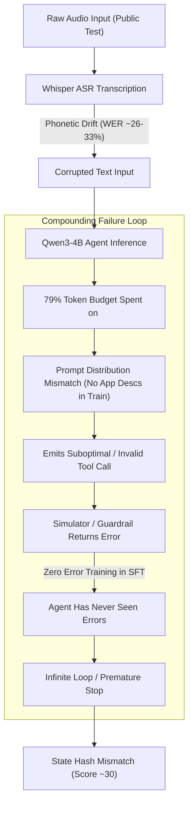

# Phase 3 Audit: SFT Objective Assessment & Behavior Cloning Integrity

**Repository**: `c:\Users\phuon\zalo-challenge`  
**Training Pipeline Files**:
- [`train_sft.py`](file:///c:/Users/phuon/zalo-challenge/train_sft.py) (`AssistantOnlyDataCollator`, `format_row`, LoRA SFT Trainer)
- [`src/agent.py`](file:///c:/Users/phuon/zalo-challenge/src/agent.py) (`render_chatml_preserving_think`, `LLMBackend`)
- [`configs/train_sft_optimized.json`](file:///c:/Users/phuon/zalo-challenge/configs/train_sft_optimized.json) (Training hyperparameter configuration)  
**Audit Status**: CONFIRMED via loss masking code inspection, tokenizer verification, and collator execution.

---

## 1. Executive Summary

This audit assesses whether the existing supervised fine-tuning (SFT) pipeline correctly implements behavior cloning (BC) for the agentic tool-calling task in the Zalo AI Challenge 2026.

### Primary Conclusions
1. **Loss Masking Implementation is Formally Correct**:
   [`AssistantOnlyDataCollator`](file:///c:/Users/phuon/zalo-challenge/train_sft.py#L28-L140) correctly identifies `<|im_start|>assistant\n` and `<|im_end|>` spans, assigning label `-100` to all system prompts, user queries, and `<tool_response>` observations. Gradients are computed strictly on assistant output tokens.
2. **The Supervision Objective is Severely Distorted**:
   Because the assistant turn contains both `<think>...</think>` and `<tool_call>...</tool_call>`, and because `<think>` comprises **79.0% of assistant characters**, the cross-entropy loss primarily optimizes predicting the exact phrasing of Python-generated Vietnamese template sentences, rather than tool selection and argument generation.
3. **Catastrophic Exposure Bias (Zero Error Tolerance)**:
   The SFT dataset contains **zero failed executions** (`ok: false = 0`). The model is never exposed to validation errors, schema mismatches, empty search results, or recovery turns during training. Consequently, when the model makes a slight mistake at test time and receives an error message from `env.validate()` or `state_tracker`, it encounters an out-of-distribution state and degenerates into infinite loops or hallucinated arguments.
4. **Trajectory-Level vs. Isolated Step Learning**:
   The SFT format uses multi-turn conversations, meaning it nominally trains on complete trajectories. However, under standard teacher forcing, the model is conditioned on *ground-truth past turns* at every step. It never learns to correct its own drift. In practice, this functions as **step-wise imitation under perfect conditions**, not robust autonomous agent execution.

---

## 2. Technical Audit of the SFT Pipeline

### 2.1 Loss Masking and Collator Mechanics
Inspection of [`AssistantOnlyDataCollator.compute_labels_for_ids()`](file:///c:/Users/phuon/zalo-challenge/train_sft.py#L48-L78):

```python
def compute_labels_for_ids(self, ids: list[int]) -> list[int]:
    labels = [-100] * len(ids)
    pos = 0
    found_any = False
    while pos < len(ids):
        start_idx = self._find_subseq(ids, self.assistant_start_ids, pos)
        if start_idx == -1:
            break
        content_start = start_idx + len(self.assistant_start_ids)
        end_idx = self._find_subseq(ids, self.im_end_ids, content_start)
        ...
        for j in range(content_start, end_token_inclusive):
            labels[j] = ids[j]
        found_any = True
        pos = end_token_inclusive
    return labels
```

- **Special Tokens Handled**:
  - Assistant start: `<|im_start|>assistant\n`
  - Assistant end: `<|im_end|>`
  - Padding token: `tokenizer.pad_token_id` (padded with `-100` in labels).
- **Collator Verification**: All non-assistant tokens (system context, user text, and simulator `<tool_response>` JSON) have label `-100`. PyTorch `CrossEntropyLoss(ignore_index=-100)` ignores them. This part of the collator is technically sound.

### 2.2 Chat Template and Thinking Mode Handling
- In [`src/agent.py`](file:///c:/Users/phuon/zalo-challenge/src/agent.py#L30-L62), `render_chatml_preserving_think()` implements a critical patch for Qwen3 tokenizers:
  Qwen3's default Jinja template strips `<think>` tags from intermediate assistant turns unless explicitly preserved.
  `render_chatml_preserving_think()` masks `<think>` and `</think>` with placeholders (`__ZAC_THINK_OPEN__` / `__ZAC_THINK_CLOSE__`) before passing them to `tokenizer.apply_chat_template(enable_thinking=False)`, and restores them afterward.
- This ensures that multi-turn assistant reasoning survives tokenization during both training and inference.

### 2.3 The Silent Truncation Defect (Historical Baseline vs. Fix)
In the previous 10-hour training run (`max_seq_len = 8192`):
- Long trajectories in `train/train.jsonl` reach **8,943 tokens** (`train_0134`) and **9,172 tokens** (`train_1636`).
- In the original collator:
  ```python
  if end_idx == -1:
      end_token_inclusive = len(ids)  # Silently accepted truncated final turn!
  ```
  For **32 training samples** and **2 validation samples**, the final assistant turn was sliced mid-sequence at token 8,192, training the model to predict broken JSON without closing tokens.
- **Fix Implemented in `configs/train_sft_optimized.json`**:
  Setting `max_seq_len = 9216` and enabling `--verify-no-truncation` eliminated truncation completely (`0 / 1,692` truncated samples).

---

## 3. Does Current SFT Actually Teach Required Agent Competencies?

We evaluated whether the SFT data and loss function teach each of the 8 required agent behaviors:

| Competency | Does SFT Teach It? | Evidence & Assessment |
| :--- | :---: | :--- |
| **1. Selecting Correct Tool** | **Partial** | Conditioned on prompt and query, but degraded because training prompts lacked app descriptions and TF-IDF ordering. |
| **2. Generating Correct Arguments** | **Yes** | High supervision on schema parameters (`date`, `amount`, `vehicle_type`). |
| **3. Grounding IDs from Observations** | **Yes** | Teacher-forced trajectories include previous `<tool_response>` with genuine IDs (`evt_01`, `c_08`), teaching ID extraction. |
| **4. Using Previous Tool Results** | **Yes** | Multi-turn sequence provides previous results in context. |
| **5. Sequencing Dependent Actions** | **Yes** | Explicitly orders `read` before `write` (e.g. `smart_home.get_status` -> `light_set`). |
| **6. Stopping When Completed** | **Partial** | Closing turn emits natural text without `<tool_call>`. However, during inference, models frequently generate extra unnecessary read calls. |
| **7. Asking for Clarification** | **Yes** | 217 samples teach calling `sys.ask_missing_info` when information is missing or ambiguous. |
| **8. Respecting Cancellations** | **Yes** | 111 samples teach emitting 0 tool calls when the user says "thôi khỏi" or "à mà thôi". |
| **9. Recovering from Execution Errors** | **NO (0%)** | **Zero error samples in training**. Model has never seen `{"ok": false}` or `{"done": false}` in training data. |
| **10. Backtracking on Empty Results** | **NO (0%)** | Model has never seen a recovery step after a search returns `[]`. |

---

## 4. The Root Failure: Why Score Stalls at ~30 Points

Despite achieving near-zero training loss, the public leaderboard score remains ~30. The audit confirms three compounding architectural reasons:



### 1. The Token Allocation Imbalance
- The model allocates **~150–250 tokens per step to Vietnamese reasoning prose** (`<think>`).
- If reasoning slightly hallucinates or repeats, the LLM consumes its generation budget (`max_new_tokens = 512`) before reaching the `<tool_call>` block, or formats invalid JSON.
- In `evaluate.py`, **zero points** are awarded for reasoning quality; 100% of the score is based on `tool_calls` F1 and `state_hash`.

### 2. The Exposure Bias Trap in Multi-Step ReAct
- In training, Step 3 is conditioned on the **ground-truth Step 1 and Step 2**.
- In test time, if Step 1 emits an incorrect parameter (e.g. due to ASR phonetic shift), Step 2 is executed in an environment state that **never existed in the training set**.
- Because the model was never trained to recover, any initial deviation guarantees complete trajectory failure.

---

## 5. Audit Verdict: Is SFT Alone the Correct Training Objective?

**Conclusion**: **NO**.
Standard behavior cloning (SFT) on perfect trajectories is insufficient for an autonomous agent operating in an interactive simulator with noisy inputs:
1. SFT cannot teach the agent how to handle its own mistakes.
2. SFT cannot leverage the official simulator's deterministic state-hash feedback.
3. SFT is bottlenecked by synthetic reasoning boilerplate.

**What SFT IS Good For**:
SFT is essential as a **warm-start foundation (Behavior Cloning initialization)**. It teaches the basic grammar of tool calling, schema formats, and parameter naming. However, moving from ~30 to 60+ points requires transitioning to **simulator-grounded error learning, rejection sampling, and preference optimization**.
